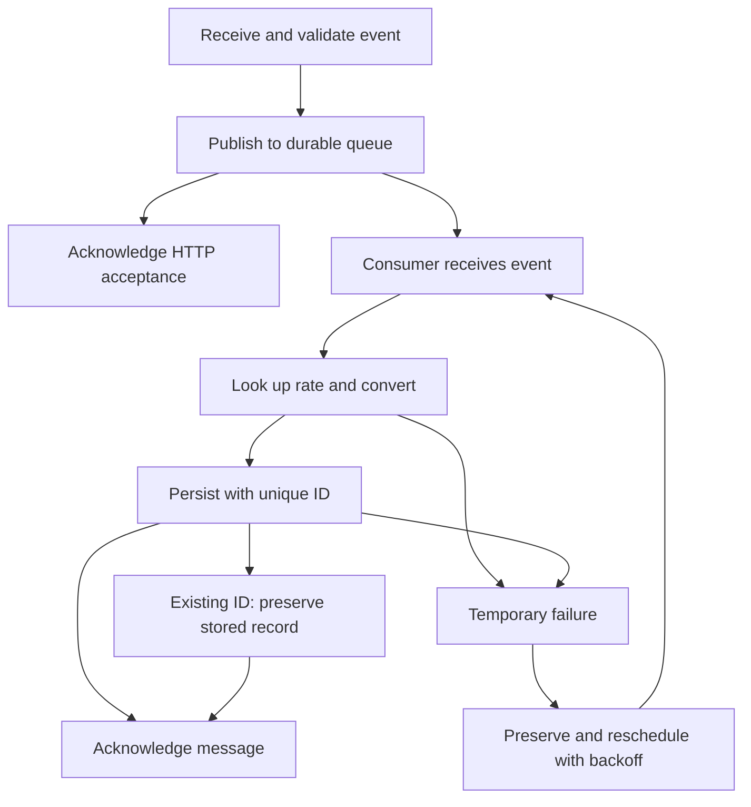

# Async Transaction Processing Service — Specification v0.1

- **Status:** Draft for review
- **Approach:** Specification Driven Development (SDD)
- **Language:** Python
- **Repository:** https://github.com/Eugeniobr/async-processing
- **Assignment:** https://gist.github.com/jrand0m/74946ab36c5e467ff04ac81b784e8daa

This document formalizes the expected behavior and acceptance criteria before implementation. Choices not fixed by the assignment are presented as proposals. No implementation is included in this version.

## 1. Objective and Scope

Build a Python service that receives transaction events, processes them asynchronously, and supports queries over their USD-converted values.

The deliverable must include:

- An HTTP API for event ingestion and queries.
- A queue and a consumer.
- Persistence and deduplication.
- Retry handling with backoff during downstream outages.
- At least one operational metric.
- Docker Compose, tests, and an English README.
- A public Git repository containing the solution.

The assignment specifies an expected load of approximately **100 events per second, with bursts of 1,000 events per second**. Capacity must be measured rather than assumed from the architecture.

The README must explain how to run the service, why the queue was chosen, one trade-off, and what would change at ten times the load. The candidate must be able to explain every part of the submitted code and modify it during the follow-up interview.

## 2. Event Contract

| Field | Proposed specification |
| --- | --- |
| `id` | Nonempty string; global transaction identifier and deduplication key. |
| `user_id` | Nonempty string identifying the user. |
| `amount` | Finite decimal value; monetary calculations must not use `float`. |
| `currency` | Supported currency code consisting of three uppercase letters. |
| `timestamp` | ISO 8601 date and time with a timezone; normalized to UTC. |

Negative amounts and zero will initially be accepted because the assignment does not restrict the sign of a transaction.

Monetary values will be represented as **decimal strings** in JSON to preserve precision.

Invalid events must be rejected before they enter the queue.

## 3. Processing Workflow

The HTTP response confirms **acceptance for processing**, not completion of conversion.

Queries follow a separate short path: **API → repository → PostgreSQL**.

## 4. Functional Requirements and Acceptance Criteria

| ID | Requirement | Acceptance criterion |
| --- | --- | --- |
| FR01 | Receive transactions through `POST /transactions`. | A valid event returns `202` only after the queue confirms durable publication. |
| FR02 | Validate incoming events. | An invalid event returns `422` and is not published. |
| FR03 | Handle publication failures. | Without confirmation from the queue, the API returns `503`; the client can resend the same `id`. |
| FR04 | Convert amounts to USD. | Store the original amount, currency, applied rate, and converted amount. Use a rate of `1` for USD. |
| FR05 | Deduplicate by `id`. | Repeated deliveries, including concurrent deliveries, produce at most one persisted transaction. |
| FR06 | Preserve events during temporary failures. | Database or exchange-rate lookup unavailability does not cause an accepted event to be discarded. |
| FR07 | Resume after interruption. | An unacknowledged event becomes available for processing again after recovery. |
| FR08 | Query a user's summary. | Return the USD total and count of persisted transactions. A user without transactions receives zero for both. |
| FR09 | Query paginated transaction history. | Return only the requested user's transactions, respecting the time range, ordering, and pagination. |
| FR10 | Expose an operational metric. | A `/metrics` endpoint exposes at least processing failures. |

## 5. Delivery Semantics and Deduplication

Use **at-least-once delivery with idempotent persistence**.

This means:

- A message may be delivered more than once.
- The database enforces uniqueness of `id`.
- The consumer acknowledges the message after the database commit.
- If the consumer stops between commit and acknowledgment, reprocessing must not duplicate the transaction.
- If messages share an `id` but have different contents, **the first persisted record wins**.

The user summary will be computed from persisted transactions. It will not rely on an independently maintained counter that could diverge from those records.

## 6. Currency Conversion and Precision

The exchange-rate convention must be explicit:

**USD amount = original amount × USD per unit of the original currency**

Proposed policy: use the rate corresponding to the **UTC date of the event**, so queue delays do not change the exchange-rate reference date.

Store the rate actually applied and its reference date.

Use `Decimal` for monetary calculations. Storage precision and rounding rules must be specified before persistence is implemented.

The exchange-rate source remains to be selected, including its policy for dates without a published rate.

## 7. Failures and Retries

| Situation | Expected behavior |
| --- | --- |
| Database or exchange-rate service unavailable | Reschedule with exponential backoff and a maximum delay. |
| Consumer interrupted | Recover messages that have not been acknowledged. |
| Duplicate transaction already persisted | Preserve the existing record and acknowledge the message. |
| Permanently invalid message | Route it to a durable failure queue for inspection and reprocessing. |

Retries must not rely exclusively on in-memory timers.

The original message may be acknowledged only after either its processing result or its durable forwarding has been confirmed.

## 8. Query Contracts

| Endpoint or rule | Proposed behavior |
| --- | --- |
| `GET /users/{user_id}/summary` | Return `total_usd` and `transaction_count`. |
| `GET /users/{user_id}/transactions?from=&to=&limit=&offset=` | Filter by the event timestamp; `from` is inclusive and `to` is exclusive. |
| Pagination | Default `limit`: 50; maximum: 100. `offset` must be nonnegative. |
| Ordering | Ascending `timestamp`, with `id` as the tie-breaker. |
| Invalid query parameters | Return `422`. |

Queries reflect only events that have already been processed. A recently accepted transaction may therefore not be visible immediately.

Offset pagination is a simplicity trade-off. It does not provide a frozen view while concurrent inserts occur.

## 9. Design Constraints

Use **object-oriented programming, the Repository pattern, and constructor-based dependency injection**.

| Component | Responsibility |
| --- | --- |
| Transaction processor | Coordinate conversion and persistence. |
| Exchange-rate provider | Encapsulate exchange-rate retrieval. |
| Transaction repository | Encapsulate writes and queries. |
| Consumer | Control delivery, acknowledgment, and retries. |
| HTTP endpoints | Validate input and delegate work. |

Each component must have one clear responsibility and concise code.

Introduce contracts and abstractions when they serve a concrete implementation or testing need. Avoid generic base classes and layers without behavior.

Keep configuration and component assembly in one place.

## 10. Validation Strategy

The assignment requires unit tests for conversion and deduplication.

In addition, integration checks against the actual services must verify:

- Concurrent duplicate deliveries.
- Downstream unavailability.
- Recovery after consumer interruption.

Measure performance against the expected load. This draft does not yet define the duration of sustained-load or burst tests, latency targets, or a recovery-time target.

## 11. Development Sequence

1. Consolidate this specification and resolve open decisions.
2. Define classes, contracts, and repository structure.
3. Implement conversion and processing with unit tests.
4. Implement PostgreSQL persistence and concurrent deduplication.
5. Integrate the queue, consumer, and retries.
6. Add the API, metric, Docker Compose, and recovery tests.
7. Measure load capacity and complete the documentation.

Each implementation increment should be derived from the relevant specification and verified against its acceptance criteria.

## 12. Open Decisions Before Implementation

The following four decisions must be consolidated before coding:

1. **Message broker:** choose a queue that supports the specified durability, acknowledgments, and retry behavior.
2. **Exchange-rate source:** choose the provider and define the policy for dates without a published rate.
3. **Monetary precision and rounding:** define storage precision and rounding rules.
4. **Backoff parameters:** define the initial delay, growth policy, and maximum delay.

These choices must support the behaviors specified above.
